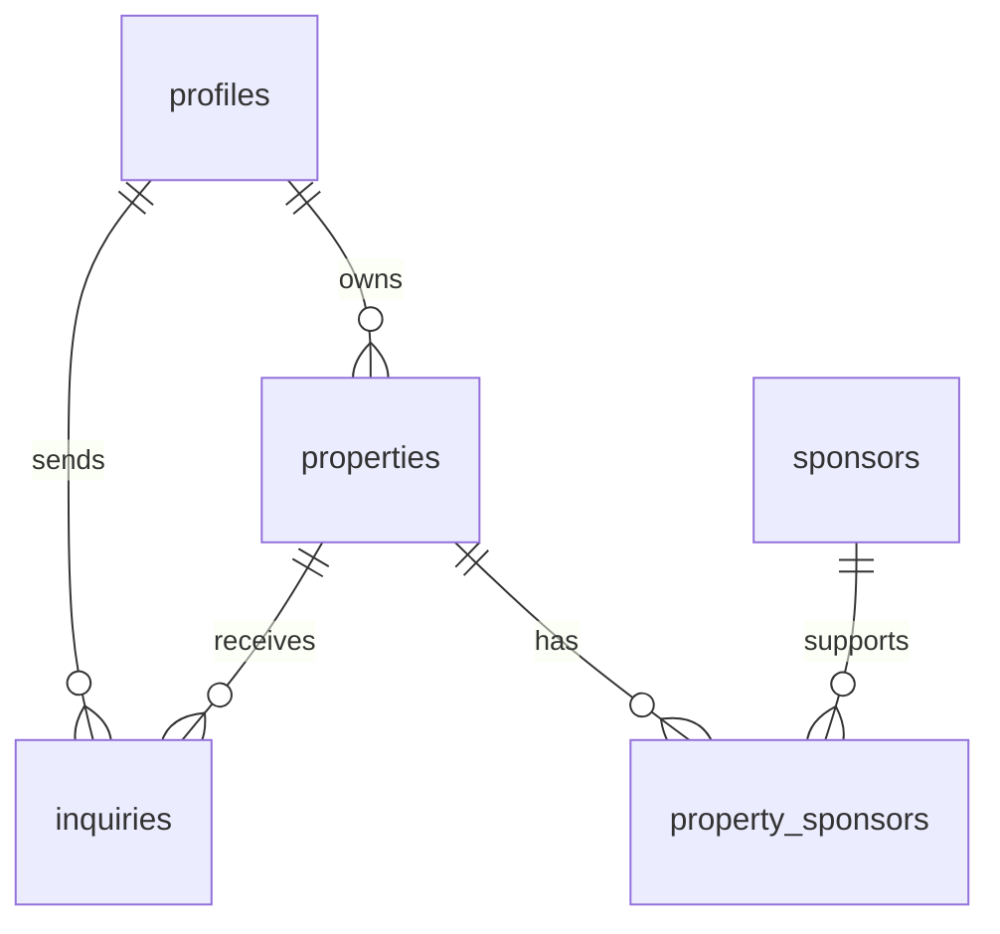

# Lab 5 Database Design

Partners: Charles Braden and Diana Moron-Mendez

## Tables

- properties: Stores property listings and their owners.
- sponsors: Stores businesses that sponsor listings.
- property_sponsors: Connects properties with sponsors.
- profiles: Stores user profile information.
- inquiries: Stores users' questions about properties.

## Relationships

